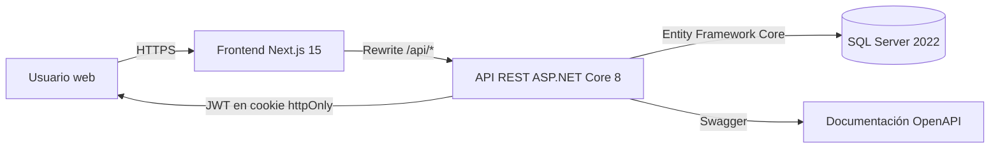
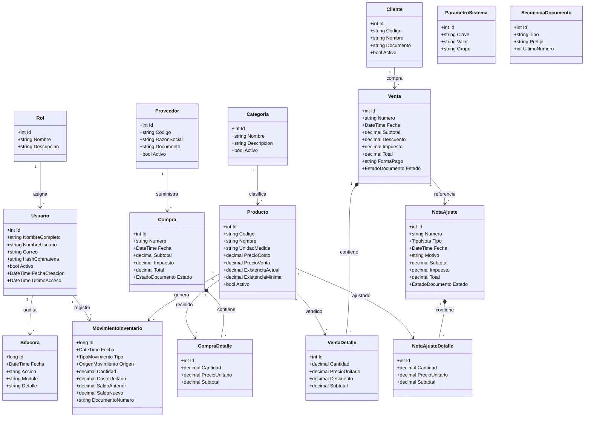
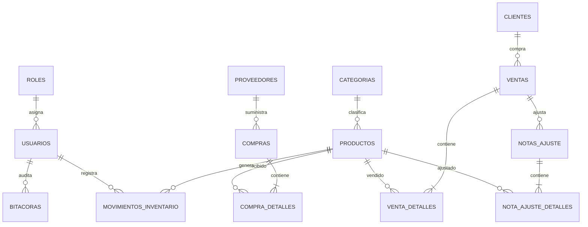
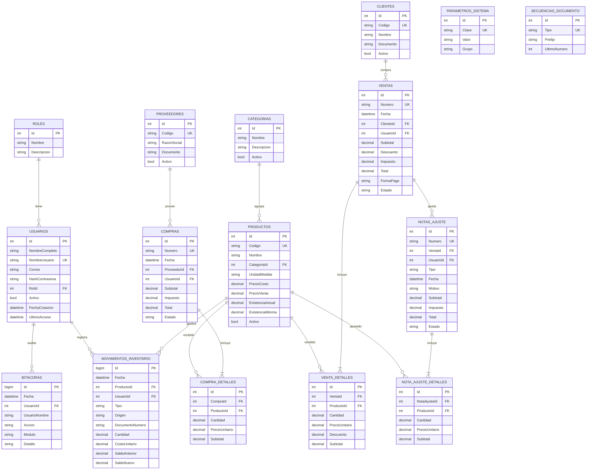

# Sistema de Inventarios

## Informe del proyecto

**Asignatura:** Desarrollo de Sistemas de Información  
**Docente / Facilitador:** _[Completar nombre]_  
**Período académico:** 2026  
**Fecha de entrega:** 31 de octubre de 2026

### Integrantes

| N.º | Nombre completo | Cédula | Participación |
|---:|---|---|---:|
| 1 | _[Integrante 1]_ | _[Cédula]_ | 25 % |
| 2 | _[Integrante 2]_ | _[Cédula]_ | 25 % |
| 3 | _[Integrante 3]_ | _[Cédula]_ | 25 % |
| 4 | _[Integrante 4]_ | _[Cédula]_ | 25 % |

> Ajustar nombres, cédulas y porcentajes según la participación real del equipo.

### Enlaces del proyecto

| Recurso | Enlace |
|---|---|
| Aplicación publicada | _[Pendiente de despliegue]_ |
| Repositorio frontend | _[Pendiente de publicar]_ |
| Repositorio backend | _[Pendiente de publicar]_ |
| Informe en Google Drive | _[Pendiente de subir]_ |
| Video en Google Drive | _[Pendiente de subir]_ |

---

## Índice

1. Introducción
2. Misión, visión y objetivos
3. Justificación
4. Alcances y límites
5. Requerimientos funcionales
6. Requerimientos no funcionales
7. Reglas de negocio
8. Módulos funcionales
9. Roles y permisos
10. Arquitectura del sistema
11. Modelo de datos
12. Diagrama de clases
13. Diagrama entidad-relación
14. Tecnologías utilizadas
15. Pruebas realizadas
16. Cronograma
17. Porcentaje de participación
18. Conclusiones y recomendaciones
19. Bibliografía
20. Anexos

---

## 1. Introducción

La gestión manual de inventarios suele generar diferencias entre las existencias físicas y los registros, pérdida de trazabilidad sobre las compras y ventas, dificultad para valorizar el inventario y poca claridad sobre las responsabilidades de cada usuario. En una empresa comercial, estos problemas afectan directamente la rentabilidad, el servicio al cliente y la toma de decisiones.

El **Sistema de Inventarios** es una aplicación web que centraliza la administración de proveedores, productos, clientes, compras, ventas, notas de crédito y débito, movimientos de entrada y salida, existencias y reportes. El sistema incorpora autenticación mediante JWT, control de acceso por roles, parámetros configurables y un historial de auditoría que permite reconstruir las operaciones realizadas.

El proyecto se desarrolló con una arquitectura cliente-servidor: un frontend en Next.js, una API REST en ASP.NET Core 8 y una base de datos SQL Server 2022. La solución puede ejecutarse localmente y está preparada para publicarse en servicios en la nube.

## 2. Misión, visión y objetivos

### 2.1 Misión

Proporcionar a las pequeñas y medianas empresas una herramienta web confiable, segura e intuitiva para controlar sus existencias y operaciones comerciales, facilitando la trazabilidad de cada movimiento y la toma de decisiones basada en información actualizada.

### 2.2 Visión

Ser una solución de referencia para la gestión de inventarios en Panamá, caracterizada por su facilidad de uso, su capacidad de adaptación a distintos parámetros empresariales y la transparencia de su información operativa y financiera.

### 2.3 Objetivo general

Desarrollar e implementar un sistema web de inventarios que integre la gestión de proveedores, productos, compras, ventas, notas de crédito y débito, movimientos y existencias, mediante acceso seguro por roles, parámetros configurables y reportes que permitan controlar y auditar las operaciones de la empresa.

### 2.4 Objetivos específicos

1. Diseñar una base de datos relacional que garantice la integridad de los documentos, los detalles y los movimientos de inventario.
2. Implementar una API REST segura con autenticación JWT y autorización basada en roles.
3. Desarrollar un frontend web responsive con menú principal, formularios validados, tablas paginadas y documentos imprimibles.
4. Automatizar la actualización de existencias y del costo promedio en compras, ventas, notas y ajustes.
5. Generar reportes de ventas, compras, notas, productos más vendidos, productos bajo mínimo, existencias y kardex.
6. Incorporar parámetros configurables para empresa, impuesto, moneda, inventario y prefijos documentales.
7. Verificar el funcionamiento del sistema mediante pruebas de integración y compilación de producción.
8. Documentar el sistema y preparar su despliegue, operación y presentación.

## 3. Justificación

El control de inventarios es una actividad crítica para cualquier empresa que compra y vende productos. Cuando los registros se llevan en hojas de cálculo o en documentos separados, es común encontrar:

- diferencias entre el stock físico y el stock registrado;
- ventas de productos sin existencia;
- compras no reflejadas oportunamente;
- dificultad para conocer el costo real del inventario;
- notas de crédito o débito sin relación con la venta original;
- falta de control sobre quién registró o anuló una operación;
- reportes desactualizados para la gerencia.

El sistema resuelve estos problemas mediante una base de datos centralizada, reglas de negocio automatizadas y un registro cronológico de movimientos. Además, el uso de roles permite separar las responsabilidades de inventario, ventas, consulta y administración.

La solución es pertinente para el curso porque integra contenidos de análisis de requerimientos, diseño de bases de datos, programación web, seguridad, arquitectura de software y documentación de proyectos.

## 4. Alcances y límites

### 4.1 Alcances

El sistema incluye:

1. **Seguridad:** inicio y cierre de sesión, cookie `httpOnly`, JWT, cambio de contraseña y autorización por roles.
2. **Catálogos:** proveedores, categorías, productos y clientes, con búsqueda, filtros, activación e inactivación.
3. **Compras:** registro con número secuencial, impuesto configurable, costo promedio ponderado, movimiento de entrada y anulación con reversión.
4. **Ventas:** registro con validación de existencias, descuentos por línea, impuesto, formas de pago, movimiento de salida y anulación con reversión.
5. **Notas de crédito y débito:** creación desde una venta registrada, afectación del inventario, límite de crédito disponible y anulación administrativa.
6. **Movimientos:** consulta filtrada por producto, tipo, origen y fecha; resumen de entradas y salidas; ajustes manuales de inventario.
7. **Existencias:** listado valorizado, alertas de stock mínimo, exportación CSV y kardex por producto.
8. **Reportes:** resumen del período, ventas, compras, notas, productos más vendidos y productos bajo mínimo.
9. **Parámetros:** datos de la empresa, impuesto inicial, moneda, reglas de inventario, prefijos de documentos y duración de sesión.
10. **Usuarios:** creación, edición, activación, asignación de rol y restablecimiento de contraseña.
11. **Auditoría:** bitácora de acciones relevantes y movimientos de inventario inmutables.
12. **Documentos:** comprobantes imprimibles de compras, ventas y notas.

### 4.2 Límites

El sistema no incluye, en esta versión:

- contabilidad general, estados financieros o conciliación bancaria;
- facturación electrónica fiscal ni integración con la DGI;
- múltiples empresas, sucursales o almacenes;
- inventario por lotes, series o fechas de vencimiento;
- lectura de códigos de barras con hardware especializado;
- pasarela de pagos en línea;
- aplicación móvil nativa;
- notificaciones automáticas por correo o mensajería;
- funcionamiento sin conexión;
- nómina, cuentas por cobrar o cuentas por pagar;
- conversión entre múltiples monedas;
- migración automática de datos desde otros sistemas.

El impuesto **ITBMS de Panamá** se utiliza únicamente como valor inicial de demostración (7 %). No es una regla fija del sistema: el porcentaje puede modificarse en los parámetros y ajustarse en cada documento. Los documentos históricos conservan el impuesto con el que fueron registrados.

## 5. Requerimientos funcionales

| Código | Requerimiento | Descripción | Prioridad |
|---|---|---|---|
| RF-01 | Inicio de sesión | Permitir el acceso con usuario y contraseña; generar un JWT y almacenarlo en una cookie `httpOnly`. | Alta |
| RF-02 | Control por roles | Restringir las operaciones según el rol: Administrador, Inventario, Ventas o Consulta. | Alta |
| RF-03 | Cierre de sesión | Eliminar la cookie de sesión y redirigir al login. | Alta |
| RF-04 | Gestión de proveedores | Crear, consultar, editar, activar e inactivar proveedores. | Alta |
| RF-05 | Gestión de categorías | Administrar las categorías de productos y consultar cuántos productos agrupan. | Media |
| RF-06 | Gestión de productos | Registrar código, nombre, categoría, unidad, costo, precio, existencia mínima y estado. | Alta |
| RF-07 | Gestión de clientes | Crear, consultar, editar, activar e inactivar clientes. | Alta |
| RF-08 | Registro de compras | Registrar una compra con varias líneas, impuesto y observaciones; aumentar existencias y recalcular el costo promedio. | Alta |
| RF-09 | Anulación de compras | Anular una compra registrada, revertir el inventario y conservar el documento para auditoría. | Alta |
| RF-10 | Registro de ventas | Registrar una venta con varias líneas, descuentos, impuesto y forma de pago; validar existencias. | Alta |
| RF-11 | Anulación de ventas | Anular una venta registrada y devolver las existencias al inventario. | Alta |
| RF-12 | Notas de crédito | Registrar una devolución o descuento posterior sobre una venta; devolver existencias. | Alta |
| RF-13 | Notas de débito | Registrar un cargo adicional sobre una venta; descontar existencias. | Alta |
| RF-14 | Anulación de notas | Anular una nota registrada y revertir su efecto en el inventario. | Alta |
| RF-15 | Movimientos de inventario | Consultar entradas y salidas con filtros por producto, tipo, origen y fecha. | Alta |
| RF-16 | Ajustes de inventario | Registrar entradas o salidas manuales con costo y observación. | Alta |
| RF-17 | Listado de existencias | Consultar existencias, mínimo, valor al costo y valor de venta; filtrar por categoría y bajo mínimo. | Alta |
| RF-18 | Kardex | Consultar el historial cronológico de un producto con saldo anterior y saldo nuevo. | Alta |
| RF-19 | Reportes | Generar reportes por período de ventas, compras, notas, resumen, productos top y bajo mínimo. | Alta |
| RF-20 | Exportación CSV | Exportar movimientos, existencias, kardex y reportes a CSV. | Media |
| RF-21 | Impresión | Imprimir comprobantes de compras, ventas y notas. | Media |
| RF-22 | Parámetros del sistema | Configurar empresa, impuesto, moneda, inventario, prefijos y duración de sesión. | Alta |
| RF-23 | Gestión de usuarios | Crear usuarios, asignar roles, activar/inactivar y restablecer contraseñas. | Alta |
| RF-24 | Perfil | Consultar los datos de la sesión y cambiar la contraseña propia. | Media |
| RF-25 | Panel de control | Mostrar indicadores de ventas, compras, productos, movimientos y alertas. | Media |
| RF-26 | Bitácora | Registrar acciones relevantes con usuario, módulo, acción y fecha. | Media |

## 6. Requerimientos no funcionales

| Código | Requerimiento | Criterio de aceptación |
|---|---|---|
| RNF-01 | Seguridad | La contraseña se almacena con hash; el JWT viaja en cookie `httpOnly`, `SameSite=Lax` y `Secure` en producción. |
| RNF-02 | Autorización | Las rutas sensibles de la API validan el rol mediante atributos `[Authorize(Roles = ...)]`. |
| RNF-03 | Usabilidad | La interfaz debe ser responsive, con navegación lateral, mensajes de error claros y formularios validados. |
| RNF-04 | Rendimiento | Las consultas paginadas deben responder en tiempos adecuados para volúmenes académicos y de pequeña empresa. |
| RNF-05 | Integridad | Las operaciones que afectan inventario y documentos deben ejecutarse dentro de transacciones. |
| RNF-06 | Mantenibilidad | El backend debe separar controladores, DTO, entidades, servicios y configuraciones EF. |
| RNF-07 | Portabilidad | El frontend y el backend deben poder publicarse en servicios en la nube compatibles con Next.js y .NET 8. |
| RNF-08 | Compatibilidad | La aplicación debe funcionar en navegadores modernos de escritorio y dispositivos móviles. |
| RNF-09 | Auditabilidad | Las anulaciones no eliminan documentos; generan movimientos de reversión y conservan el historial. |
| RNF-10 | Configurabilidad | El impuesto, la moneda, los prefijos y la duración de sesión deben administrarse sin recompilar. |
| RNF-11 | Disponibilidad | La base de datos debe contar con respaldo y el hosting debe ofrecer disponibilidad continua. |
| RNF-12 | Documentación | El repositorio debe incluir instrucciones de instalación, operación, despliegue y pruebas. |

## 7. Reglas de negocio

| Código | Regla |
|---|---|
| RN-01 | Los códigos de productos, proveedores y clientes deben ser únicos. |
| RN-02 | Los catálogos no se eliminan cuando tienen historial: se inactivan para conservar la integridad referencial. |
| RN-03 | Toda compra registrada genera una entrada de inventario y actualiza el costo promedio ponderado del producto. |
| RN-04 | Toda venta registrada genera una salida de inventario. |
| RN-05 | Una venta se rechaza si la cantidad solicitada supera la existencia, salvo que el parámetro `Inventario.PermitirStockNegativo` esté en `true`. |
| RN-06 | El impuesto debe ser un valor entre 0 y 100. El 7 % de ITBMS es solo el valor inicial configurable. |
| RN-07 | Las líneas de una venta deben tener cantidad mayor que cero, precio no negativo y descuento no negativo. |
| RN-08 | Una nota de crédito requiere una venta registrada y solo puede incluir productos de esa venta. |
| RN-09 | El total acumulado de notas de crédito registradas no puede superar el total de la venta de referencia. |
| RN-10 | Una nota de crédito devuelve existencias al inventario; una nota de débito descuenta existencias. |
| RN-11 | Una nota de débito está limitada por la existencia disponible, salvo que se permita stock negativo. |
| RN-12 | Solo el rol Administrador puede anular compras, ventas y notas. |
| RN-13 | Un documento anulado no puede anularse nuevamente y no se elimina de la base de datos. |
| RN-14 | La anulación de una compra, venta o nota genera los movimientos de reversión correspondientes. |
| RN-15 | Los documentos registrados no se editan: se anulan y se emite uno nuevo. |
| RN-16 | La numeración es secuencial por tipo de documento y utiliza el prefijo configurado. |
| RN-17 | Los movimientos de inventario son inmutables y registran saldo anterior, saldo nuevo, costo, usuario y fecha. |
| RN-18 | El kardex se presenta en orden cronológico y permite reconstruir el saldo del producto. |
| RN-19 | Un producto está bajo mínimo cuando su existencia actual es menor o igual a la existencia mínima. |
| RN-20 | Los parámetros de empresa, impuesto, moneda, prefijos y sesión solo pueden modificarse por el Administrador. |
| RN-21 | La duración de la sesión debe estar entre 5 y 43 200 minutos. |
| RN-22 | El usuario activo no puede desactivar su propia cuenta desde la interfaz. |
| RN-23 | Toda operación relevante se registra en la bitácora con el usuario que la ejecutó. |
| RN-24 | Las contraseñas deben tener al menos 8 caracteres al crearse o cambiarse. |
| RN-25 | Los documentos históricos conservan el impuesto, precios y datos con los que fueron registrados. |

## 8. Módulos funcionales

| Módulo | Funciones principales | Usuarios |
|---|---|---|
| Seguridad | Login, logout, sesión, cambio de contraseña | Todos |
| Panel de control | Indicadores, serie de ventas, top productos, alertas y últimas ventas | Todos |
| Proveedores | CRUD lógico, búsqueda, activación | Administrador, Inventario |
| Categorías | CRUD lógico, conteo de productos | Administrador, Inventario |
| Productos | CRUD lógico, precios, existencias, mínimos | Administrador, Inventario |
| Clientes | CRUD lógico, búsqueda | Administrador, Ventas |
| Compras | Registro, detalle, impresión y anulación | Administrador, Inventario |
| Ventas | Registro, validación de stock, detalle, impresión y anulación | Administrador, Ventas |
| Notas | Crédito, débito, detalle, impresión y anulación | Administrador, Ventas |
| Movimientos | Consulta, resumen y ajuste manual | Administrador, Inventario, Consulta |
| Existencias | Listado valorizado, filtros, CSV y kardex | Todos |
| Reportes | Resumen, ventas, compras, notas, top y bajo mínimo | Todos |
| Parámetros | Empresa, impuesto, moneda, inventario, prefijos y sesión | Administrador |
| Usuarios | CRUD, roles, estado y restablecimiento de clave | Administrador |
| Perfil | Datos de sesión y cambio de contraseña | Todos |
| Bitácora | Registro de acciones y trazabilidad | Administrador (base para auditoría) |

## 9. Roles y permisos

| Rol | Permisos principales |
|---|---|
| **Administrador** | Acceso completo; anulaciones; parámetros; usuarios; todos los reportes. |
| **Inventario** | Productos, categorías, proveedores, compras, ajustes, existencias y reportes. |
| **Ventas** | Clientes, ventas, notas de crédito/débito, existencias y reportes. |
| **Consulta** | Acceso de solo lectura a catálogos, movimientos, existencias, reportes y perfil. |

La API aplica la autorización real. El menú del frontend oculta opciones no permitidas, pero la seguridad no depende de la interfaz.

## 10. Arquitectura del sistema



### Capas del backend

1. **Controladores:** exponen los endpoints REST y aplican autorización.
2. **DTO:** definen los contratos de entrada y salida.
3. **Servicios:** contienen reglas de negocio, transacciones y cálculos.
4. **Datos:** DbContext, configuraciones EF Core, migraciones y datos iniciales.
5. **Middleware:** transforma excepciones de negocio en respuestas JSON consistentes.
6. **Seguridad:** configuración JWT, cookie y extensión para obtener el usuario autenticado.

### Estructura del frontend

- `src/app`: rutas del App Router (login, panel, catálogos, operaciones, reportes).
- `src/components`: layout, UI compartida y componentes de inventario.
- `src/lib`: cliente HTTP, tipos TypeScript, formatos, hooks y parámetros de empresa.
- `src/middleware.ts`: protección de rutas por presencia de cookie.

## 11. Modelo de datos

La base de datos se denomina `SistemaInventarios` y está compuesta por las siguientes tablas principales:

| Tabla | Propósito |
|---|---|
| `Roles` | Catálogo de roles del sistema. |
| `Usuarios` | Cuentas de acceso y relación con el rol. |
| `Categorias` | Clasificación de productos. |
| `Productos` | Catálogo, precios y existencia actual. |
| `Proveedores` | Empresas que suministran productos. |
| `Clientes` | Compradores registrados. |
| `Compras` / `CompraDetalles` | Documento de compra y sus líneas. |
| `Ventas` / `VentaDetalles` | Documento de venta y sus líneas. |
| `NotasAjuste` / `NotaAjusteDetalles` | Notas de crédito y débito. |
| `MovimientosInventario` | Historial de entradas y salidas. |
| `ParametrosSistema` | Configuración general. |
| `SecuenciasDocumento` | Correlativos por tipo de documento. |
| `Bitacoras` | Auditoría de acciones. |

## 12. Diagrama de clases



## 13. Diagrama entidad-relación

### 13.1 Vista conceptual



### 13.2 Diccionario de datos resumido

| Tabla | Clave primaria | Claves foráneas | Campos principales |
|---|---|---|---|
| `ROLES` | `Id` | — | `Nombre`, `Descripcion` |
| `USUARIOS` | `Id` | `RolId` | `NombreCompleto`, `NombreUsuario` (único), `Correo`, `HashContrasena`, `Activo`, `FechaCreacion`, `UltimoAcceso` |
| `CATEGORIAS` | `Id` | — | `Nombre`, `Descripcion`, `Activo` |
| `PRODUCTOS` | `Id` | `CategoriaId` | `Codigo` (único), `Nombre`, `UnidadMedida`, `PrecioCosto`, `PrecioVenta`, `ExistenciaActual`, `ExistenciaMinima`, `Activo` |
| `PROVEEDORES` | `Id` | — | `Codigo` (único), `RazonSocial`, `Documento`, `Activo` |
| `CLIENTES` | `Id` | — | `Codigo` (único), `Nombre`, `Documento`, `Activo` |
| `COMPRAS` | `Id` | `ProveedorId`, `UsuarioId` | `Numero` (único), `Fecha`, `Subtotal`, `Impuesto`, `Total`, `Estado` |
| `COMPRA_DETALLES` | `Id` | `CompraId`, `ProductoId` | `Cantidad`, `PrecioUnitario`, `Subtotal` |
| `VENTAS` | `Id` | `ClienteId`, `UsuarioId` | `Numero` (único), `Fecha`, `Subtotal`, `Descuento`, `Impuesto`, `Total`, `FormaPago`, `Estado` |
| `VENTA_DETALLES` | `Id` | `VentaId`, `ProductoId` | `Cantidad`, `PrecioUnitario`, `Descuento`, `Subtotal` |
| `NOTAS_AJUSTE` | `Id` | `VentaId`, `UsuarioId` | `Numero` (único), `Tipo`, `Fecha`, `Motivo`, `Subtotal`, `Impuesto`, `Total`, `Estado` |
| `NOTA_AJUSTE_DETALLES` | `Id` | `NotaAjusteId`, `ProductoId` | `Cantidad`, `PrecioUnitario`, `Subtotal` |
| `MOVIMIENTOS_INVENTARIO` | `Id` | `ProductoId`, `UsuarioId` | `Fecha`, `Tipo`, `Origen`, `DocumentoNumero`, `Cantidad`, `CostoUnitario`, `SaldoAnterior`, `SaldoNuevo`, `Observacion` |
| `PARAMETROS_SISTEMA` | `Id` | — | `Clave` (único), `Valor`, `Grupo` |
| `SECUENCIAS_DOCUMENTO` | `Id` | — | `Tipo` (único), `Prefijo`, `UltimoNumero` |
| `BITACORAS` | `Id` | `UsuarioId` | `Fecha`, `UsuarioNombre`, `Accion`, `Modulo`, `Detalle` |

<!-- pdf-inicio-oculto -->
### 13.3 Modelo detallado

La siguiente vista incluye las claves primarias, claves foráneas y los campos principales de cada tabla.


<!-- pdf-fin-oculto -->

## 14. Tecnologías utilizadas

| Componente | Tecnología | Versión |
|---|---|---|
| Frontend | Next.js + React + TypeScript | 15.5.28 / 19.1 / 5 |
| Estilos | Tailwind CSS | 4 |
| Gráficos | Recharts | 3.10 |
| Iconos | Lucide React | 1.59 |
| Backend | ASP.NET Core | 8 |
| ORM | Entity Framework Core | 8.0.10 |
| Autenticación | JWT Bearer + cookie httpOnly | 8.0.10 |
| Documentación API | Swagger / OpenAPI | 6.6.2 |
| Base de datos | SQL Server | 2022 |
| Control de versiones | Git + GitHub | — |
| Despliegue previsto | Vercel + MonsterASP.NET | — |

## 15. Pruebas realizadas

### 15.1 Compilación

| Prueba | Resultado |
|---|---|
| `dotnet build` del backend | Correcta, 0 errores y 0 advertencias. |
| `npm run build` del frontend | Correcta, 22 rutas generadas, sin advertencias de ESLint. |
| Migración `20261020054853_Inicial` | Aplicada correctamente en SQL Server. |

### 15.2 Pruebas de integración de API

| Escenario | Resultado esperado | Resultado obtenido |
|---|---|---|
| `GET /api/health` | Estado correcto | Correcto |
| Login de los cuatro usuarios | Sesión y rol correctos | Correcto |
| Compra de 1 unidad | Stock +1 | Correcto |
| Anulación de compra | Stock vuelve al valor inicial | Correcto |
| Venta de 1 unidad | Stock −1 | Correcto |
| Anulación de venta | Stock vuelve al valor inicial | Correcto |
| Nota de crédito de 1 unidad | Stock +1 | Correcto |
| Anulación de nota | Stock vuelve al valor inicial | Correcto |
| Ajuste de entrada de 2 unidades | Stock +2 | Correcto |
| Ajuste de salida de 2 unidades | Stock vuelve al valor inicial | Correcto |
| Existencias y resumen | Totales y valorización coherentes | Correcto |
| Kardex por producto | Movimientos con saldo anterior/nuevo | Correcto |
| Reportes por período | Datos y exportación disponibles | Correcto |
| Documentos de prueba | Depurados después de las pruebas | Correcto |

### 15.3 Pruebas funcionales recomendadas antes de la entrega

1. Iniciar sesión con cada uno de los cuatro roles y verificar el menú.
2. Crear un proveedor, una categoría, un producto y un cliente.
3. Registrar una compra y verificar el aumento de existencia.
4. Registrar una venta y verificar la disminución de existencia.
5. Intentar vender más de la existencia disponible y confirmar el rechazo.
6. Crear una nota de crédito desde la venta y verificar el retorno de stock.
7. Crear una nota de débito y verificar la salida de stock.
8. Anular una nota como Administrador y verificar la reversión.
9. Registrar un ajuste manual y consultar el kardex.
10. Exportar existencias, movimientos y reportes a CSV.
11. Imprimir una compra, una venta y una nota.
12. Cambiar parámetros y verificar que el nuevo valor se use en documentos nuevos.
13. Restablecer la contraseña de un usuario y probar el nuevo acceso.
14. Verificar que un usuario de Consulta no pueda ejecutar operaciones de escritura.

## 16. Cronograma

| Semana | Período | Actividades | Entregable | Estado |
|---|---|---|---|---|
| 1 | 05–11 oct 2026 | Análisis del problema, requerimientos, alcances y diseño inicial | Documento de análisis | Completado |
| 2 | 12–18 oct 2026 | Modelo de datos, migraciones, seguridad, catálogos y API base | Backend base + BD | Completado |
| 3 | 19–25 oct 2026 | Compras, ventas, notas, movimientos, existencias, reportes y frontend | Sistema integrado | Completado |
| 4 | 26–31 oct 2026 | Pruebas, despliegue, informe, video y enlaces en Canvas | Entrega final | En curso |

### Hitos

| Fecha | Hito |
|---|---|
| 12 oct 2026 | Base de datos y autenticación funcionando. |
| 19 oct 2026 | API de operaciones y catálogos completa. |
| 23 oct 2026 | Frontend con todos los módulos. |
| 27 oct 2026 | Pruebas de integración y compilación de producción. |
| 29 oct 2026 | Publicación en Vercel y MonsterASP.NET. |
| 30 oct 2026 | Informe PDF y video cargados en Google Drive. |
| 31 oct 2026 | Enlaces entregados en Canvas. |

## 17. Porcentaje de participación

| Integrante | Análisis y diseño | Backend / BD | Frontend | Pruebas / despliegue | Documentación / video | Total |
|---|---:|---:|---:|---:|---:|---:|
| _[Integrante 1]_ | 5 % | 10 % | 5 % | 3 % | 2 % | **25 %** |
| _[Integrante 2]_ | 5 % | 5 % | 10 % | 3 % | 2 % | **25 %** |
| _[Integrante 3]_ | 5 % | 5 % | 5 % | 5 % | 5 % | **25 %** |
| _[Integrante 4]_ | 5 % | 5 % | 5 % | 4 % | 6 % | **25 %** |
| **Total** | **20 %** | **25 %** | **25 %** | **15 %** | **15 %** | **100 %** |

> La tabla es una plantilla. Debe reflejar la participación real y coincidir con lo explicado en el video.

## 18. Conclusiones y recomendaciones

### Conclusiones

- El sistema centraliza las operaciones de inventario y reduce la dependencia de registros manuales.
- La integración entre compras, ventas, notas y movimientos permite reconstruir el historial de cada producto.
- La validación de existencias y el control de roles disminuyen errores operativos y accesos no autorizados.
- La configuración de impuesto, moneda y prefijos facilita la adaptación a distintas empresas sin cambiar el código.
- La arquitectura utilizada separa responsabilidades y permite mantener o ampliar el sistema por módulos.

### Recomendaciones

1. Realizar respaldos periódicos de la base de datos y probar la restauración.
2. Cambiar las contraseñas de demostración antes de publicar la aplicación.
3. Utilizar una clave JWT robusta y almacenarla como variable de entorno.
4. Habilitar `Auth__CookieSegura=true` en producción.
5. Definir políticas de complejidad y rotación de contraseñas.
6. Incorporar en una siguiente versión el soporte para múltiples almacenes y sucursales.
7. Evaluar la integración con lectores de código de barras y facturación electrónica.
8. Programar auditorías periódicas de la bitácora y de los ajustes manuales.

## 19. Bibliografía

- Microsoft. (2024). *ASP.NET Core documentation*. https://learn.microsoft.com/aspnet/core
- Microsoft. (2024). *Entity Framework Core documentation*. https://learn.microsoft.com/ef/core
- Microsoft. (2024). *SQL Server documentation*. https://learn.microsoft.com/sql
- Vercel. (2026). *Next.js documentation*. https://nextjs.org/docs
- Vercel. (2026). *Deploying Next.js to Vercel*. https://vercel.com/docs
- MonsterASP.NET. (2026). *Documentación de hosting ASP.NET Core*. https://www.monsterasp.net
- OWASP Foundation. (2024). *OWASP Application Security Verification Standard*.
- Pressman, R. y Maxim, B. (2020). *Ingeniería del software: un enfoque práctico* (9.ª ed.). McGraw-Hill.

## 20. Anexos

### Anexo A. Usuarios de demostración

| Usuario | Contraseña | Rol |
|---|---|---|
| `admin` | `Admin123!` | Administrador |
| `bodega` | `Inventario123!` | Inventario |
| `vendedor` | `Ventas123!` | Ventas |
| `consulta` | `Consulta123!` | Consulta |

### Anexo B. Endpoints principales

| Método | Ruta | Descripción |
|---|---|---|
| GET | `/api/health` | Estado de la API |
| POST | `/api/auth/login` | Inicio de sesión |
| POST | `/api/auth/logout` | Cierre de sesión |
| GET | `/api/auth/me` | Sesión actual |
| POST | `/api/auth/cambiar-contrasena` | Cambio de contraseña |
| GET/POST | `/api/productos` | Listado y creación de productos |
| GET/PUT/DELETE | `/api/productos/{id}` | Consulta, edición e inactivación |
| GET/POST | `/api/proveedores` | Proveedores |
| GET/POST | `/api/clientes` | Clientes |
| GET/POST | `/api/categorias` | Categorías |
| GET/POST | `/api/compras` | Compras |
| POST | `/api/compras/{id}/anular` | Anulación de compra |
| GET/POST | `/api/ventas` | Ventas |
| POST | `/api/ventas/{id}/anular` | Anulación de venta |
| GET/POST | `/api/notas` | Notas de crédito y débito |
| POST | `/api/notas/{id}/anular` | Anulación de nota |
| GET | `/api/movimientos` | Movimientos |
| POST | `/api/movimientos/ajuste` | Ajuste manual |
| GET | `/api/movimientos/resumen` | Resumen de movimientos |
| GET | `/api/existencias` | Existencias |
| GET | `/api/existencias/resumen` | Resumen valorizado |
| GET | `/api/reportes/resumen` | Resumen del período |
| GET | `/api/reportes/ventas` | Reporte de ventas |
| GET | `/api/reportes/compras` | Reporte de compras |
| GET | `/api/reportes/notas` | Reporte de notas |
| GET | `/api/reportes/top-productos` | Productos más vendidos |
| GET | `/api/reportes/bajo-minimo` | Productos bajo mínimo |
| GET | `/api/reportes/kardex` | Kardex por producto |
| GET/PUT | `/api/parametros` | Consulta y actualización de parámetros |
| GET/POST | `/api/usuarios` | Usuarios |
| GET | `/api/usuarios/roles` | Roles disponibles |
| PUT | `/api/usuarios/{id}` | Edición de usuario |
| PUT | `/api/usuarios/{id}/contrasena` | Restablecimiento de contraseña |

### Anexo C. Variables de entorno

**Backend**

```text
ConnectionStrings__Inventarios=Server=...;Database=SistemaInventarios;User Id=...;Password=...;
Jwt__Key=<clave de al menos 32 caracteres>
Jwt__Issuer=SistemaInventarios.Api
Jwt__Audience=SistemaInventarios.Web
Jwt__MinutosExpiracion=480
Auth__CookieSegura=true
Cors__Origenes__0=https://<dominio-frontend>
ASPNETCORE_ENVIRONMENT=Production
```

**Frontend**

```text
API_URL=https://<dominio-backend>
```

### Anexo D. Estructura del repositorio

```text
sistema-inventarios/
├── backend/
│   └── Inventarios.Api/
│       ├── Controladores/
│       ├── Datos/
│       │   ├── Configuraciones/
│       │   └── Migraciones/
│       ├── DTOs/
│       ├── Entidades/
│       ├── Extensiones/
│       ├── Middleware/
│       ├── Seguridad/
│       ├── Servicios/
│       ├── appsettings.json
│       └── Program.cs
├── frontend/
│   ├── src/
│   │   ├── app/
│   │   ├── components/
│   │   ├── lib/
│   │   └── middleware.ts
│   └── package.json
├── docs/
├── .gitignore
└── README.md
```

### Anexo E. Enlaces de entrega

| Elemento | Enlace |
|---|---|
| Aplicación publicada | _[Pendiente]_ |
| Repositorio GitHub | _[Pendiente]_ |
| Informe PDF en Google Drive | _[Pendiente]_ |
| Video en Google Drive | _[Pendiente]_ |
| Publicación en Canvas | _[Pendiente]_ |

---

**Declaración:** El presente informe documenta el diseño, desarrollo, pruebas y estado de entrega del Sistema de Inventarios. Los nombres, enlaces y porcentajes definitivos deben completarse antes de la entrega final.
